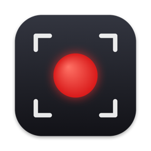

# 录屏 · Screen Recorder



一个很小的 Mac 录屏工具：选整个屏幕、某个窗口或框一块区域，连同电脑播放的声音（可选麦克风）一起录成 MP4。

A tiny macOS screen recorder: record a whole screen, a single window or a selected area, together with system audio (and optionally your microphone), straight to MP4. The interface follows your system language (Chinese / English).

## 下载 Download

到 [Releases](../../releases/latest) 下载 `ScreenRecorder.dmg`，打开后把「录屏」拖进「应用程序」。

**要求：** Apple 芯片（M1 及以后）的 Mac，macOS 15 或更新。

**第一次打开会被系统拦下**（这个 App 没有经过苹果公证）：
1. 双击打开，看到提示后点「完成」或「取消」；
2. 打开 系统设置 → 隐私与安全性，往下找到「已阻止打开"录屏"」，点「仍要打开」；
3. 第一次录制时，按提示在 系统设置 → 隐私与安全性 → 屏幕与系统录音 里打开「录屏」，然后退出再重新打开。

> First launch is blocked by Gatekeeper because the app isn't notarized: open it once, then go to System Settings → Privacy & Security and click "Open Anyway". Requires an Apple silicon Mac with macOS 15+.

## Windows 版 Windows

Windows 10 / 11（64 位）可用：下载 `ScreenRecorder-Windows-x64.zip`，解压后双击「录屏.exe」（整个文件夹放一起，不用另装运行库）。第一次打开如果出现「Windows 已保护你的电脑」，点「更多信息 → 仍要运行」。

- 录整个屏幕、单个窗口，或框选一块区域（遮罩上拖八个点调大小，点「录制」直接开录，Esc 取消）
- 同时录电脑声音和麦克风（混成一条音轨），可选是否显示鼠标
- 全局快捷键 **Ctrl+Alt+R** 开始 / 停止；录屏窗口本身不会被录进画面
- 文件保存在「视频 \ 录屏」，录完用默认播放器打开
- **Windows 版暂不支持 Studio 效果**

> **Windows:** unzip `ScreenRecorder-Windows-x64.zip` and run `录屏.exe` (Windows 10/11 x64; no extra runtime needed). Records a screen, a window or a selected area with system audio and/or microphone mixed into one track; **Ctrl+Alt+R** starts / stops; saved to Videos\录屏. Studio effects are not available on Windows yet. If SmartScreen warns on first launch, click "More info → Run anyway".
>
> 源码在 `windows/`（C# WinForms，.NET Framework 4.8 + [ScreenRecorderLib](https://github.com/sskodje/ScreenRecorderLib)），GitHub Actions 自动编译打包并真录几秒自测。Source in `windows/`, built and self-tested by GitHub Actions.

## 功能 Features

- 录整个屏幕、单个窗口，或者像系统截图（⌘⇧5）那样框选一块区域，拖八个点调大小
- 同时录电脑声音和麦克风（各一条音轨），可选是否显示鼠标
- 全局快捷键 **⌥⌘R** 开始 / 停止（游戏全屏、点不到按钮时也能用）
- 按屏幕原始像素录制，不缩放；颜色和苹果自带录屏一致
- 文件保存在「影片 / 录屏」
- **Studio 效果**（像 Screen Studio）：打开开关后正常录就行，录完自动出片——点击、打字的地方镜头自动推近，鼠标轨迹更顺滑、点击有波纹，背景透明（存成带透明通道的 .mov，放进剪辑软件可以叠在任意画面上），带圆角和阴影。原始素材留在「影片 / 录屏 / Studio 素材」

  **Studio effects** (Screen Studio–style): record as usual and get a polished video automatically — auto-zoom on clicks and typing, smoothed cursor with click ripples, transparent background (saved as HEVC-with-alpha .mov, ready to overlay in any editor) with rounded corners and shadow.

## 自己编译 Build from source

只需要命令行开发工具（`xcode-select --install`），不用 Xcode：

```sh
./build.sh      # 编译并装到 /Applications
./package.sh    # 打安装包 dist/ScreenRecorder.dmg
```
